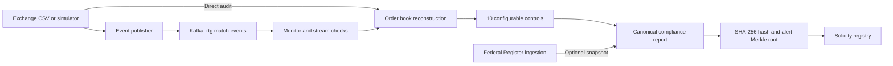

# Vigil — Trade Surveillance & Compliance


**Reconstruct an exchange's order books, detect suspicious trading, and produce independently verifiable audit reports.**

Vigil is a personal engineering project built around Optiver's [Ready Trader Go](https://readytradergo.optiver.com/)
exchange simulator. It consumes order and trade events, runs **10 configurable surveillance controls**,
and records the evidence behind each alert. Matches can be audited from a CSV, simulated locally, or
monitored through Kafka while the exchange runs. Reports have deterministic SHA-256 fingerprints and
can be anchored to a Solidity registry with Merkle proofs for individual alerts.

**Start here:** [Run the example](#quick-start) · [Review the implementation](#code-review-guide) ·
[Controls](docs/CONTROLS.md) · [Architecture](docs/ARCHITECTURE.md) · [CLI workflows](docs/USAGE.md)

## What the project demonstrates

| Area | Implementation |
| --- | --- |
| Surveillance | Reconstruct both order books, recover trade counterparties, reconcile reported fills, and apply controls configured in YAML. |
| Stream recovery | Deduplicate sequence numbers, detect missing events, and commit explicit Kafka offsets only after reporting, while retaining restart points for unfinished matches. |
| Audit integrity | Canonical JSON, deterministic alert IDs, SHA-256 report hashes, Merkle inclusion proofs, and a write-once Solidity registry. |
| Regulatory context | Ingest Federal Register documents, deduplicate and hash their contents, and attach a snapshot of relevant updates to reports. |
| Verification | Test against adversarial traders, corrupted event streams, captured exchange output, Kafka, and a local Ethereum node. |

The exchange, matching engine, and sample market data are an external Optiver dependency. Vigil's
implementation is in `src/vigil/` and `contracts/`. This is a research prototype for a simulated market;
its alerts are review signals, not determinations of misconduct or regulatory compliance.

## How it works



Each alert includes the participant, control, severity, and supporting event sequence numbers.
The report records the input stream and rulebook hashes, reconciliation results, participant metrics,
and, for Kafka runs, whether the complete event stream arrived.

## Quick start

Use **Python 3.11–3.13**; Python 3.12 is a good default. The commands below work in a macOS or Linux
shell. The initial install needs internet access. Afterward, this example runs locally without Kafka,
Java, a wallet, or API credentials.

```bash
git clone https://github.com/ChibunduAwandu/vigil.git
cd vigil
python3.12 -m venv .venv
source .venv/bin/activate
python -m pip install -e '.[dev]'
python scripts/bootstrap_rtg.py

vigil simulate --session 2 --scenario rogues --match-id quickstart --no-regulatory
```

The setup script downloads the separately licensed exchange and four sample sessions into the ignored
`pyready_trader_go-2/` directory. It uses a pinned community mirror and verifies each file's SHA-256.
See [dependency provenance and licensing](NOTICE.md). Keep the editable install: the CLI uses this
checkout's configuration, models, and exchange files.

The example simulates a 15-minute match with three baseline traders and six deliberately abusive
traders, then audits it. A verified run on Python 3.12 produced this summary:

```text
report quickstart: 66 alerts, worst CRITICAL; record reconciles (1,393 trades checked)
```

Exact counts can change with numerical-library versions or model changes. The useful checks are that
reconciliation succeeds, the abusive scenarios generate alerts, and the baseline traders remain clean.

| Output | What to inspect |
| --- | --- |
| `artifacts/reports/quickstart/report.md` | Readable findings, participant summaries, and evidence. |
| `artifacts/reports/quickstart/report.json` | Canonical report used for hashing and verification. |
| `artifacts/reports/quickstart/match_events.csv` | The simulated exchange's event stream. |
| `artifacts/reports/quickstart/score_board.csv` | Scores and exchange outcomes. |

A [checked-in example report](docs/examples/quickstart.md) is available without installing anything.
To print your own report and check the file's fingerprint:

```bash
vigil report artifacts/reports/quickstart/report.json
shasum -a 256 artifacts/reports/quickstart/report.json  # Linux: sha256sum
pytest -m 'not chain and not kafka and not network and not live'
```

## The ten controls

Thresholds and regulatory references live in [config/rulebook.yaml](config/rulebook.yaml).
The [control reference](docs/CONTROLS.md) explains the evidence and limitations of each detector.

| ID | Control | ID | Control |
| --- | --- | --- | --- |
| LIM-01 | Position limits | MKT-03 | Quote stuffing |
| LIM-02 | Unhedged exposure duration | MKT-04 | Marking the close |
| LIM-03 | Message rate | MKT-05 | Order-to-trade ratio |
| MKT-01 | Spoofing and layering | MKT-06 | Off-market orders |
| MKT-02 | Wash trading | REC-01 | Trade reconciliation |

## Code review guide

Follow one event through the system, then inspect the failure cases:

| Start with | What to look for | Supporting tests |
| --- | --- | --- |
| [Event schema](src/vigil/rtg/events.py) → [market reconstruction](src/vigil/surveillance/market.py) → [surveillance engine](src/vigil/surveillance/engine.py) | Recover books and counterparties; stop judging a match after a gap makes the books unreliable. | [Surveillance](tests/test_surveillance.py), [exchange rules](tests/test_exchange_rules.py) |
| [Monitor](src/vigil/bus/services.py) and [Kafka adapter](src/vigil/bus/kafka.py) | Sequence deduplication, stream hashes, interleaved matches, and explicit offset boundaries. | [Delivery and restart cases](tests/test_bus.py) |
| [Report builder](src/vigil/reports/builder.py) and [canonical serialization](src/vigil/reports/canonical.py) | Stable report bytes, strict JSON parsing, and evidence fingerprints. | [Reports](tests/test_reports.py) |
| [Merkle trees](src/vigil/chain/merkle.py) and [Solidity registry](contracts/src/ComplianceRegistry.sol) | Individual alert proofs, authorized reporters, write-once report IDs, and filing history. | [Python/chain integration](tests/test_chain.py), [Solidity tests](contracts/test/ComplianceRegistry.t.sol) |
| [Regulatory ingestion](src/vigil/regulatory/scraper.py) and [document store](src/vigil/regulatory/store.py) | Content hashes, incremental ingestion, and snapshots used in reports. | [Regulatory ingestion](tests/test_regulatory.py) |

## Kafka and on-chain verification

Install the optional dependencies and local services to exercise the full pipeline:

```bash
python -m pip install -e '.[all]'
make tools       # downloads Kafka and Foundry; Kafka needs Java 17+
make services    # localhost Kafka and Anvil
```

In one terminal (with the virtual environment activated):

```bash
vigil monitor --group review --once --no-regulatory
```

In a second terminal:

```bash
source .venv/bin/activate
vigil simulate --session 2 --scenario rogues --match-id kafka-review --publish --no-regulatory
```

On a fresh broker the monitor writes `artifacts/reports/kafka-review/report.json` and reports stream
completeness. For an existing broker, consumer groups can replay older matches; see the
[Kafka workflow](docs/USAGE.md#monitor-through-kafka).

To anchor the quick-start report on the local development chain:

```bash
# Use local settings for this terminal, even if public-network variables were previously exported.
export VIGIL_ETH_RPC=http://127.0.0.1:8545
unset VIGIL_ETH_PRIVATE_KEY VIGIL_REGISTRY ETHERSCAN_API_KEY
vigil chain anchor artifacts/reports/quickstart/report.json
vigil chain verify artifacts/reports/quickstart/report.json
make stop
```

Only fingerprints and filing metadata go on chain; the report stays off chain. A successful check
establishes that the file matches a filing in the trusted registry. It does not establish that the
underlying events or the detector's conclusions are true.

[CLI workflows](docs/USAGE.md) also cover captured matches, live exchange runs, regulatory ingestion,
alert proofs, and the full demo.

## Guarantees and boundaries

- **At-least-once delivery:** a restarted monitor replays from retained match headers. Alert consumers
  must deduplicate by alert ID. This is not Kafka transactional exactly-once processing.
- **Deterministic reports:** identical inputs and software produce identical bytes. Inputs include the
  match header, event stream, rulebook, optional regulatory snapshot, and delivery diagnostics. A changed
  snapshot or different duplicate/missing-event counts can change the report hash.
- **Missing events:** the monitor records gaps and stops surveillance beyond the first gap instead of
  continuing with an incorrect book. Kafka retention must keep the events needed for recovery.
- **Prototype operations:** state is held in memory and recovery replays a match. Production operation
  would require partition-rebalance handling, bounded state, monitoring, and deployment hardening.
- **Detection evidence:** the recorded evaluation covers 36 simulated matches. All eight abusive
  scenarios were flagged in each of four sessions, with no alerts against baseline traders in that
  evaluation. The scenarios and thresholds were developed together; this is not an independent measure
  of real-market detection accuracy. [Methods and recorded results](docs/RESULTS.md#surveillance).

The repository also includes a deterministic simulator, market-making strategies, and forecasting
experiments used to generate and compare trading behavior. Their historical results and caveats are
in [docs/RESULTS.md](docs/RESULTS.md); they are separate from the surveillance guarantees. Full historical
live-match recordings are not checked in. A short captured match is included in the test fixtures.

## Development and attribution

```bash
make lint-python
make test                         # optional integrations skip when unavailable
make contract                     # Solidity tests; requires Foundry from make tools
VIGIL_TEST_LIVE=1 .venv/bin/pytest  # also run the actual exchange integration tests
```

Local verification on Python 3.12: **245 Python tests passed** across the main suite and the Kafka
integration run, plus **30 Solidity tests** (including fuzz tests). The three public API tests were
not run. Ruff and Solidity formatting checks passed. See the [verification record](docs/VERIFICATION.md).

An optional [GitHub Actions workflow](docs/ci.yml) covers Python 3.11–3.13, the example,
Kafka/live-exchange integration, and Solidity. Hosted CI is not enabled yet; publishing the workflow
requires workflow-write permission. See [CONTRIBUTING.md](CONTRIBUTING.md) for the development workflow.

By **Chibundu Awandu**. This project is independent of Optiver. No open-source license has been selected
for Vigil's own code; see [NOTICE.md](NOTICE.md) for external dependency licenses and attribution.
